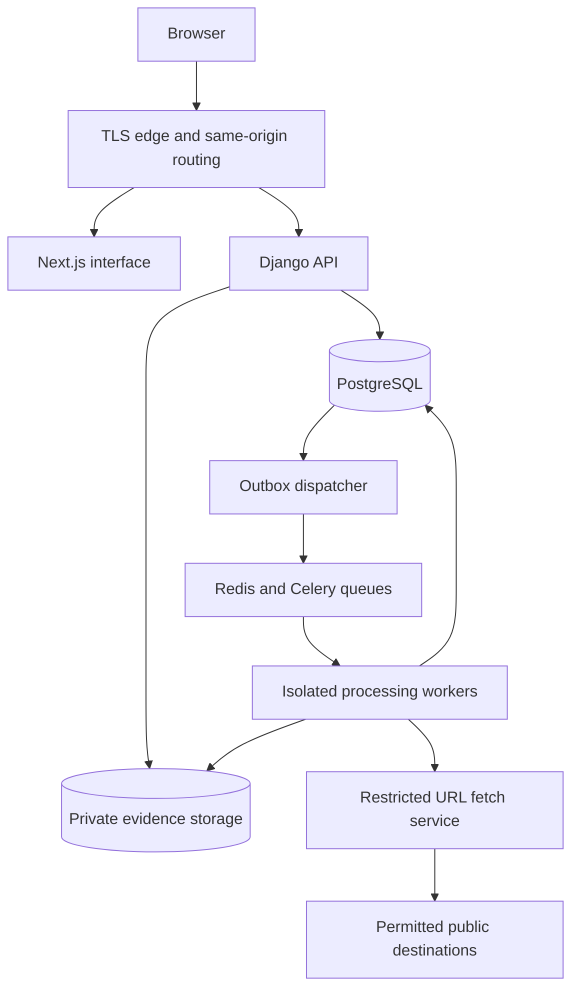
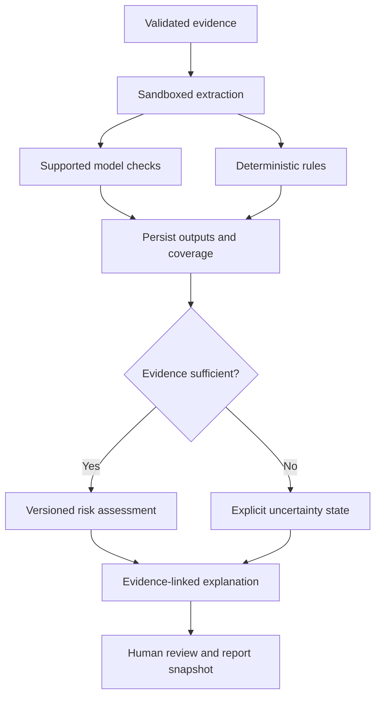

# TRUTHLENS — System Architecture

**Version:** 1.1 — Proposed implementation architecture  
**Date:** 18 October 2026  
**Companion document:** `PRD.md`  
**Status:** Design specification; no services or detection models are claimed to be implemented.

> Verify the Signal. Understand the Risk.

## 1. Scope and architectural principles

TRUTHLENS is a multi-tenant enterprise web application for media authenticity checks, suspicious-communication assessment, evidence investigation, and human review. It accepts supported images, videos, audio, emails, documents, URLs, and chat exports.

The architecture implements the PRD's seven layers: input, secure ingestion, signal extraction, AI/rules intelligence, risk assessment, explanation, and human-controlled action. An additional project reference mentioned in the source brief was not supplied; reconcile it before final architecture sign-off.

Core invariants:

1. Every finding has a traceable evidence reference and a declared provenance category.
2. Original evidence bytes remain unchanged throughout analysis; retention-authorised deletion is a separate audited operation.
3. Tenant authorisation applies to APIs, workers, searches, reports, caches, and evidence downloads.
4. Missing detectors and insufficient evidence remain explicit. Unavailable values are not replaced by zero or invented scores.
5. Model confidence, manipulation score, communication risk, and evidence completeness have separate meanings.
6. Human reviewers control consequential decisions. There is no automatic payment, person-blocking, or accusation integration.
7. Demonstration fixtures cannot be selected as fallback production detectors.

## 2. Architecture style and technology

Start with a **modular Django backend**, deployed alongside a Next.js frontend and independently scalable processing workers. Modules share PostgreSQL and explicit service interfaces. Extract services only when isolation, runtime requirements, or measured load justify the operational cost.

| Concern | Proposed technology | Responsibility |
| --- | --- | --- |
| Web interface | Next.js, React, TypeScript | Navigation, submission, results, review, dashboards, settings. |
| UI system | Tailwind CSS, Lucide, Recharts | Consistent accessible interface and evidence-backed charts. |
| API and domain logic | Python, Django REST Framework | Authorisation, orchestration, review, configuration, reporting contracts. |
| Relational persistence | PostgreSQL | Authoritative job state, evidence metadata, findings, reviews, evaluation, audit/outbox records. |
| Background orchestration | Celery with Redis broker | Dispatch and bounded retries; PostgreSQL remains the durable job source of truth. |
| Evidence storage | Private S3-compatible object storage | Quarantine, originals, derivatives, report PDFs, approved evaluation assets. |
| Extraction | FFmpeg, OpenCV, selected OCR/parsing/transcription tools | Capability-specific extraction in constrained runtimes. |
| Inference | Versioned adapters; PyTorch when needed | Real tested detector execution with documented score semantics. |
| PDF renderer | Selected server-side PDF library | Render versioned report snapshots without arbitrary external fetches. |
| Telemetry | Structured logging and metrics stack selected at deployment | Queue health, latency, failures, access and operational monitoring. |

Specific dependency versions, detector names, hosting vendor, and infrastructure sizing are implementation decisions. This document does not rely on unverified library API details.

## 3. System topology and trust boundaries

The database-to-dispatcher arrow denotes polling committed outbox records, not direct database network initiation. The browser accesses the API through the same public origin. Large uploads may use a narrowly scoped, short-lived upload authorisation for a specific quarantine object. The diagram omits those optional direct uploads for readability.

| Boundary | Policy |
| --- | --- |
| Browser → application | HTTPS, authenticated session, CSRF protection for mutations, request validation and rate limits. |
| Application → evidence storage | Service identity, private objects, tenant-scoped metadata lookup and short-lived access. |
| Trusted control plane → untrusted processing | Isolated process/container, no application secrets, constrained resource/network access, narrow job-scoped input/output grants. |
| Fetch service → public network | Approved protocols and ports, validated DNS and redirects, deny internal destinations, strict byte/time limits. |
| Worker → persistence | Trusted worker controller validates sandbox output before committing structured results. Sandboxes receive no broad database credentials. |
| Tenant → tenant | Backend scope checks and relational constraints; no shared evidence or cache access merely because hashes match. |

## 4. Frontend architecture

Use a shared application shell and feature-oriented screens for Overview, New Analysis, History, Risk Intelligence, Evidence Reports, Review Queue, Model Performance, Audit Logs, and Settings.

- API responses are authoritative for permissions, capability availability, file limits, job status, and scores.
- Separate upload progress from processing progress. Poll active jobs initially; pause or reduce polling when the page is inactive.
- Represent loading, empty, partial, insufficient-evidence, unavailable, cancelled, and failed states explicitly.
- Clear tenant-scoped client state when switching organisations or signing out.
- Do not store evidence, transcripts, tokens, or sensitive results in persistent browser caches by default.
- Render extracted text as text. Never inject uploaded HTML, email scripts, or untrusted SVG into the application origin.
- Use safe derived media previews; access to original evidence is explicit and permission-controlled.
- Keep all model/API secrets on the server. UI flags never substitute for backend permissions.

Use white surfaces, red emphasis, charcoal text, accessible risk labels, and responsive layouts as specified in the PRD. Include textual summaries for charts and status announcements for assistive technology.

## 5. Backend modules and ownership

| Module | Owns | Key dependencies |
| --- | --- | --- |
| Identity and organisations | Users, memberships, roles, sessions, grants | Audit. |
| Submissions | Analysis creation, manifest, optional context, consent snapshot | Identity, policies, evidence. |
| Evidence | Asset metadata, object references, hashes, lineage, safe access | Storage adapter, retention. |
| Orchestration | Execution plans, attempts, stage status, cancellation, outbox | Evidence, capabilities, workers. |
| Extraction | Frames, segments, text, OCR, metadata, attachments | Sandboxed tools and evidence. |
| Detection | Adapter registry, model/rule runs, outputs and availability | Extraction, version registry. |
| Risk | Versioned scoring policy, contributions, uncertainty state | Completed checks and coverage. |
| Explanations | Evidence-linked findings, limitations and recommendations | Risk and indicators. |
| Review | Assignment, requests for evidence, escalation, decisions | Identity, cases, audit. |
| Reports | Immutable snapshots, PDF jobs, authorised retrieval | Findings, review, versions, storage. |
| Evaluation | Dataset manifests, labels, splits, evaluation runs and metrics | Approved assets, detector registry. |
| Analytics | Scoped aggregates and operational trends | Durable domain records. |
| Audit and policies | Security events, retention, deletion and consent rules | All domain mutations. |

Avoid importing HTTP views into worker code. Domain services enforce invariants regardless of whether they are called from an API endpoint, scheduled task, or management command.

## 6. Submission and ingestion protocol

### 6.1 Analysis and batch semantics

One analysis is an investigation container with one or more evidence assets. Each asset has its own validation and check status. Correlation across assets runs only when explicitly supported and when contextual relationships are known; uploading files together does not establish an identity match.

1. `POST /api/analyses` validates membership, quota, category, consent and retention selection, optional context, and an idempotency key.
2. Persist the analysis and asset manifest. Return analysis ID, approved upload instructions, capability information, and limits.
3. Upload each asset to a generated quarantine key. User filenames are metadata, never object paths or shell arguments.
4. Finalisation verifies the expected object/version, actual length, and ownership. Compute server-side SHA-256 over the received bytes; client hashes are advisory.
5. Isolated validation checks MIME signatures, parser support, safety scan results, and limits. Unsupported/unsafe assets receive explicit rejection reasons.
6. Promote accepted originals to protected storage without changing bytes and record their storage version and verified digest. Quarantine remains inaccessible to normal preview/report paths.
7. In one database transaction, persist the execution plan and an outbox event. The dispatcher eventually queues processing.

Finalisation is idempotent. Abandoned multipart uploads and expired quarantine objects are cleaned up. Never enqueue analysis on an unfinalised upload. A batch with rejected assets displays those failures even if supported assets continue under the configured partial-processing policy.

### 6.2 URL, pasted text, and fetched content

Store submitted URLs and pasted text as source records with timestamps. For URLs, record the fetch attempt, inspected final URL, redirect chain, time, content type, and snapshot hash where content was acquired. Clearly distinguish a fetched snapshot from an original user-uploaded file.

No remote content is fetched from a browser preview automatically. The dedicated fetch service validates each destination and redirect, blocks internal/reserved address ranges and disallowed protocols/ports, limits decompression and response bytes, and revalidates the actual connection destination against DNS rebinding. Authenticated/private websites are outside initial scope.

## 7. Processing pipeline and execution semantics

### Queue separation

| Queue | Work | Isolation / scaling rule |
| --- | --- | --- |
| Validation | Signatures, limits, safety checks | Constrained CPU/memory and parser sandbox. |
| Extraction | Media decoding, OCR, text and attachment extraction | CPU-heavy workers, limited temporary disk, no general egress. |
| Inference | Model execution | CPU/GPU workers selected by adapter needs; approved model artifacts only. |
| Fetch | URL/domain inspection | Dedicated controlled-egress runtime. |
| Assessment | Rules aggregation, scoring, explanation | Small trusted tasks consuming validated structured outputs. |
| Reports | Snapshot rendering | Restricted renderer, approved local assets only. |
| Evaluation | Dataset benchmark runs | Separate quotas so evaluation cannot starve production. |
| Maintenance | Retention, cleanup, reconciliation | Least-privilege administrative worker. |

Workers receive opaque job/stage IDs and verify tenant, state, cancellation and evidence availability before starting. Queue payloads do not carry raw evidence, secrets, or complete transcripts.

### Durable delivery and retries

Celery delivery is treated as **at least once**. PostgreSQL stores stage attempts and authoritative outcomes. A transactional outbox avoids losing work between committing an analysis and publishing a task. A reconciler detects undispatched events and stalled jobs after broker loss.

Use uniqueness constraints on logical stage keys such as `(run_id, asset_id, check_id, configuration_digest)`. A worker claims a stage with a lease/heartbeat and commits results only while holding the valid attempt token. Duplicate deliveries cannot create duplicate accepted outputs. Temporary output objects are published by reference only after successful completion; orphaned objects are cleaned later.

Retry transient storage/network/worker errors with bounded exponential backoff and jitter. Do not retry permanently unsupported formats or invalid evidence. Record attempt history. When retry limits are reached, persist a failed check and let the finaliser determine overall status. Avoid relying on a single queue callback to decide completion; aggregate persisted stage states.

### Cancellation and job states

The PRD lifecycle is `created → uploading → validating → queued → processing → completed`, with terminal alternatives `partially_completed`, `failed`, `cancelled`, and `rejected`. Each check independently tracks `pending`, `running`, `completed`, `unavailable`, `skipped`, or `failed`.

Cancellation sets a durable request flag. Workers check it at safe boundaries; a supervisor terminates a sandbox that exceeds its deadline. In-flight outputs are not published after cancellation wins the state transition. Preserve already recorded audit/attempt history. Use database concurrency control to resolve cancellation versus completion consistently.

`partially_completed` means some planned checks produced usable outputs while others failed or were unavailable. `completed` means scheduled checks finished, not that authenticity was established. Assessment state remains separate.

## 8. Extraction and detector interfaces

### Modality handling

| Modality | Extraction / checks | Evidence anchors |
| --- | --- | --- |
| Image | Metadata and supported manipulation/generation model | Original and derivative IDs; normalised region coordinates with image dimensions. |
| Video | Sampled frames, stream metadata, available audio, supported consistency/manipulation checks | Millisecond offsets in original timeline; frame sampling/preprocessing version. |
| Audio | Decoded signal, available transcription, synthetic-speech/consistency checks | Start/end milliseconds; transcript segment and tool version. |
| Email | Headers, body, links and isolated attachments | Header names, message part, text offsets and derived asset lineage. |
| Document | Text extraction, OCR and supported embedded images | Page number, text span or bounding box; OCR quality/limitations. |
| URL | Controlled fetch and domain/redirect inspection | Fetch snapshot, URL, retrieval time, response/redirect evidence. |
| Chat | Declared TXT/JSON parser, messages and timestamps | Message IDs/indices, participant labels, export schema and text offsets. |

Store transformation lineage so a region in a resized frame maps back to the original. Do not produce localisation if an adapter cannot support it reliably. Missing headers, metadata, audio, faces, language support, or usable quality become limitations and coverage records.

### Adapter contract

Each adapter exposes:

- **Descriptor:** check ID, model/rule version, artifact digest, licence/provenance reference, accepted modalities, input constraints, hardware needs, and capabilities.
- **Availability:** configured, healthy, disabled, or unavailable with a user-safe reason.
- **Input:** scoped references to approved originals/derivatives, pinned preprocessing, applicable context, and resource budget.
- **Output:** execution status, native scores and semantics, calibration reference when available, structured indicators, confidence where supported, limitations, timings and artifact references.
- **Failure:** stable reason code, retryability, partial outputs allowed by contract, and safe diagnostics.

Validate output schemas and numeric ranges before persistence. Model output cannot choose tenant IDs, object paths, role grants, or tool actions. Cross-modal identity/consistency checks run only with an implemented adapter and suitable linked inputs; they must not fabricate an identity confirmation.

Start explanations with deterministic templates over evidence and rules. An optional future language-model layer must remain evidence-constrained, treat all submitted content as untrusted data, have no consequential tools, and validate references. It must not invent observations or confidence values.

## 9. Evidence and assessment contracts

### Evidence provenance

Every indicator has exactly one primary category: `observed_evidence`, `model_inference`, `rule_warning`, or `unverified_user_information`. Inferences and rule warnings reference their underlying observations. The evidence graph links:

`original/source snapshot → derivative → extraction/check run → indicator → assessment contribution → report snapshot`.

Version and hash outputs where reproducibility requires them. A file digest establishes byte integrity; it does not establish that the depicted event or sender is authentic. Timestamps distinguish ingestion, claimed source time, extraction time, inference time, and review time.

### Risk engine

A scoring policy is an immutable versioned configuration defining eligible signals, normalisation, weights/rules, conflict handling, minimum evidence coverage, thresholds and explanatory contribution logic. Selection is pinned when a run starts. Updating a policy does not silently recompute prior cases.

The assessment contract contains:

| Field | Meaning |
| --- | --- |
| `overall_risk_score` | Nullable 0–100 operational assessment; not a fake-content probability. |
| `manipulation_score` | Nullable score for eligible media manipulation evidence under documented mapping. |
| `communication_risk_score` | Nullable score for supported sender/content/context risks. |
| `confidence_by_check` | Native/calibrated confidence with semantics and calibration status. |
| `evidence_completeness` | Applicable expected checks/context compared with usable evidence; calculation and gaps exposed. |
| `assessment_state` | Lower risk, review recommended, high risk, inconclusive, insufficient evidence, or unavailable. |
| `contributions` | Evidence/check references and their documented effect on the assessment. |
| `policy_version` | Scoring and threshold configuration used for this run. |
| `limitations` | Missing checks, quality constraints, conflicts and unsupported claims. |

Provisional operational bands remain 0–29, 30–69, and 70–100. Use integer published scores or specify rounding before banding so fractional scores cannot fall into undefined gaps. Determine evidence sufficiency before assigning a band. Nulls are never interpreted as zero. A communication risk may be assessable while media manipulation remains unavailable; the interface must describe that scope.

No default arithmetic average or universal confidence formula is prescribed. The final scoring policy requires validation and approval before production use.

## 10. Relational data design

All tenant-owned records carry `organisation_id`. Use UUIDs, UTC timestamps, explicit schema versions for structured JSON, and indexes supporting scoped access. Avoid global cross-tenant deduplication signals visible to users.

| Entity | Important fields / constraints |
| --- | --- |
| Organisation, Membership, RoleGrant | Membership uniqueness per organisation/user; grants validated against active membership. |
| AnalysisJob | Organisation, submitter, state, context reference, mode, retention snapshot, revision. |
| AnalysisRun | Analysis, parent run, pinned capabilities/model/rule/scoring versions and configuration digests. |
| EvidenceAsset | Organisation, object key/version, size, media type, SHA-256, source kind, parent asset, expiry/deletion state. |
| RunAsset | Run/evidence relationship and contextual role; same-tenant constraint. |
| StageAttempt | Logical stage key, attempt number, lease, heartbeat, status, error code and timing. |
| DetectionResult | Run/asset/check/version, native output, validated confidence semantics, completion status. |
| EvidenceIndicator | Result/source asset, provenance category, anchors, supporting references and limitations. |
| RiskAssessment, Contribution | Run, nullable scores, state, coverage, policy version and indicator references. |
| HumanReview, ReviewEvent | Assignment, workflow state, revision; append-only actions, rationale, verification basis and actor. |
| InvestigationReport | Run and review revision, snapshot reference/digest, PDF key, version and status. |
| ModelVersion, RuleVersion, ScoringPolicy | Immutable descriptors and configuration; availability controlled separately. |
| EvaluationDataset, Sample, Run | Dataset version/source/split/verified labels, asset references, leakage checks, pinned evaluation configuration. |
| ConsentRecord, RetentionPolicy, DeletionRequest | Policy versions, scope, effective dates, approval/hold state and propagation progress. |
| AuditEvent, OutboxEvent | Attributable action or dispatch envelope; correlation ID, publication state and timestamps. |

Enforce tenant-consistent parent/child links through composite constraints where feasible and explicit service validation. Scope uniqueness and queries appropriately. Never trust a submitted organisation ID without verifying membership and object ownership. PostgreSQL row-level security can provide defence in depth if the team can correctly manage tenant context across API and worker connections; it is an explicit deployment decision, not assumed protection.

## 11. Storage, retention, and integrity

Use private storage namespaces for quarantine, originals, derivatives, reports, and evaluation datasets. Opaque object keys and separate service permissions prevent user-controlled path access; prefixes alone are not an authorisation boundary.

- Upload grants permit a single expected object and bounded size/time where the provider supports it. Finalisation always verifies actual bytes and ownership.
- Original promotion is write-once by application policy. Workers cannot overwrite originals.
- Derivatives record parent asset, transformation version and digest. Metadata stripping or transcoding creates new assets.
- Temporary workspace data is encrypted where supported and removed after success, failure, cancellation or expiry.
- Evidence access is authenticated streaming by default for sensitive records. Optional signed URLs expire quickly but remain usable until expiry; use streaming when immediate revocation is required.
- Never cache evidence responses publicly. Treat filenames, excerpts, and metadata as potentially sensitive.

Deletion first marks a record unavailable, prevents new stages/downloads, and signals active jobs. A reconciled deletion workflow then removes originals, derivatives, PDFs, cached copies and applicable indexes, tracking per-object failures until complete. Audit events retain only approved minimal metadata. Do not claim physical deletion until the configured propagation conditions are met.

Backup expiry may delay physical removal. Document the interval, prevent deleted evidence from resurfacing on restore by replaying deletion records, and verify preservation restrictions before deletion. Object lock/WORM retention is optional and must be reconciled with user-controlled deletion before enabling it.

## 12. API and session design

Use same-origin routing to the Django API and secure server-managed sessions with HttpOnly, Secure cookies and an appropriate SameSite policy. Validate CSRF on mutations and restrict CORS. Session expiry/revocation is enforced server-side. Enterprise SSO is an optional later integration.

| Method | Route | Behaviour |
| --- | --- | --- |
| POST | `/api/analyses` | Idempotent analysis/manifest creation under caller scope. |
| GET | `/api/analyses` | Scoped list with cursor pagination and allowlisted filters. |
| GET | `/api/analyses/{id}` | Durable job status, coverage and permitted results. |
| GET | `/api/analyses/{id}/evidence` | Indicators with safe asset access references. |
| GET | `/api/analyses/{id}/report` | Read-only existing report or generation status. |
| POST | `/api/analyses/{id}/review` | Revision-checked review action and transactional audit event. |
| GET | `/api/dashboard/summary` | Tenant-scoped time-range aggregates. |
| GET | `/api/audit-logs` | Restricted audit search. |
| POST | `/api/evaluation/datasets` | Authorised manifest import and validation job. |
| GET | `/api/evaluation/metrics` | Versioned cohort metrics with availability reasons. |

Proposed supporting routes include asset upload/finalisation, cancel, reanalyse, report-generation POST, review assignment, deletion requests, and capabilities. Final exact schemas belong in OpenAPI.

An idempotency key is scoped to organisation, actor and operation. Store a payload digest and return the original result for matching retries; conflicting payloads return a conflict. Mutations of review/configuration records require an expected revision, rejecting stale writes with a structured conflict response.

Errors contain `code`, safe `message`, optional field errors, `correlation_id`, and `retryable`. Do not reveal whether inaccessible cross-tenant IDs exist. Treat `202 Accepted` as queued work, not a completed result. Cap page sizes, batch sizes and export work.

## 13. Human review, reports, and audit

Review states are independent from analysis state: unassigned, assigned, in review, awaiting evidence, escalated, reviewed. Confirmed outcome is a distinct explicit record with verification basis; unresolved is valid. Reviewing a case does not create a training label automatically.

Persist each review action and its audit event in one transaction. Use optimistic concurrency to prevent overwritten decisions. New evidence or reanalysis creates a new linked run and may reopen review according to policy while preserving past outcomes.

Report generation captures an immutable structured snapshot of the run, findings, policy/model versions, evidence references, and review revision. Render the PDF from that snapshot in an isolated renderer with no arbitrary network access. Store snapshot and PDF digests; later report revisions create new records. Include limitations and DEMO marking consistently.

Audit application actions and authenticated evidence access without secrets or raw media content. Restrict ordinary application credentials from updating/deleting audit events; optionally export to a separately protected append-only destination. Hash chains can assist tamper detection but are not sufficient alone without an independently protected checkpoint. Explicitly disclose any audit coverage limits of direct signed downloads.

## 14. Evaluation and demonstration separation

### Evaluation

Import immutable dataset versions with sample IDs, media types, asset references, genuine/manipulated labels, source, split and verification status. Verify tenant access to references. Check duplicate hashes and related source families across training, validation and test splits; flag uncertain grouping for review.

Evaluation uses the same pinned preprocessing and detector contracts as production with separate queues and datasets. Persist predictions, verified labels, excluded/failed samples, confusion counts, latency distribution, thresholds and model/dataset versions. Compute precision, recall, F1, false-positive and false-negative rates only where denominators and verified labels support them. Show cohort size and class balance. Unavailable metrics remain unavailable.

### Demonstration

Use a separate demo deployment/database/storage boundary for approved synthetic or sample fixtures where feasible. Persist `mode=demo` through jobs, findings, assessments, dashboards and reports. Production registry configuration must reject demo adapters. Demo mode never assigns fixture predictions to arbitrary real uploads. A real upload with no eligible detector receives explicit unavailable checks.

Neither mode performs automatic model training. Future training requires a separately scoped, authorised data-use and pipeline design.

## 15. Deployment and operations

### Local development

Provide container-based services for Next.js, Django, PostgreSQL, Redis, private-storage emulator and separate worker processes. Use approved fixture assets only. Real model artifacts are optional capability-controlled dependencies; absent artifacts produce unavailable status.

### Initial production deployment

- TLS edge serves frontend and routes `/api` to replicated Django instances.
- Managed PostgreSQL and private object storage provide persistent state and evidence.
- Private Redis broker, outbox dispatcher and reconciler provide task dispatch.
- Separate validation/extraction, inference, fetch and report worker pools enforce runtime boundaries.
- CPU/GPU pool sizes follow measured modality workloads; inference is not colocated with public web request handling by default.
- A secret manager supplies credentials, encryption/service keys and approved processor configuration.
- Database, broker, worker control endpoints and storage administration are not publicly reachable.

Kubernetes is optional. A managed container platform is sufficient if it provides worker isolation, private networking, resource limits and required GPU access. Select hosting region and backup/recovery objectives before production. This is a deployment design, not a deployment action.

### Configuration

Document placeholder environment settings for database, broker, object storage, session security, allowed hosts/origins, worker limits, model registry, scoring policy, upload limits, retention defaults, telemetry, and demo mode. Do not put secret values in committed examples, frontend bundles, task payloads, or logs.

### Delivery pipeline

CI runs lint/type checks, unit and integration tests, tenant authorisation tests, pipeline failure tests, dependency/container checks, migration checks and frontend build. Build immutable runtime artifacts and record versions. Deploy schema changes using backward-compatible migrations before switching dependent application versions. Roll back application versions without rewriting historical evidence or detector outputs.

Model promotion follows a separate gate: artifact provenance/licence review, adapter conformance, representative evaluation, runtime benchmark, approved rollout and recorded version. Rollback disables new execution on the affected version without changing previous findings.

## 16. Observability, failure handling, and capacity

Track API latency/error rate, queue age/depth, stage duration by modality/model, lease expiry, retry count, storage failures, cancellations, report failures, detector availability and deletion backlog. Correlation IDs connect API requests, outbox records and stage attempts. Do not use sensitive text or high-cardinality evidence identifiers as general metric labels.

| Failure | Required response |
| --- | --- |
| Database unavailable | Fail writes safely; do not queue unrecorded work or claim success. |
| Broker loss | Preserve pending work in database; dispatcher/reconciler republish idempotently. |
| Worker crash | Lease expires; bounded retry resumes stage without duplicate accepted results. |
| Detector unavailable/OOM | Record unavailable/failed check; reduce coverage and show limitations. |
| Storage timeout | Retry boundedly; never publish findings whose required evidence was not committed. |
| URL blocked/unreachable | Record fetch limitation; do not infer maliciousness solely from access failure. |
| Report rendering failure | Preserve analysis; expose report failure and safe retry. |
| Evidence deletion during processing | Stop publishing new evidence outputs and reconcile temporary data. |
| Audit persistence failure | Fail the associated sensitive mutation closed; alert operators. |

Apply organisation quotas, upload limits, per-user rate limits, queue fairness, inference concurrency limits and backpressure before expensive processing. Benchmark under an agreed workload. The PRD's p95 API and status-freshness targets are proposed targets, not measured claims. Establish availability, recovery time, recovery point and evidence deletion timelines through deployment planning and restore drills.

## 17. Suggested source organisation

| Path | Contents |
| --- | --- |
| `apps/web/` | Next.js routes, feature components, accessible UI system, typed API client. |
| `apps/api/` | Django project, domain modules, REST views, permissions and migrations. |
| `processing/contracts/` | Versioned extraction/detector input-output schemas. |
| `processing/extractors/` | Isolated modality-specific tool wrappers. |
| `processing/detectors/` | Real adapter implementations and model descriptors. |
| `processing/sandboxes/` | Restricted runtime definitions and supervisor configuration. |
| `demo/` | Approved synthetic fixtures and separately enabled adapters. |
| `infra/` | Local containers, deployment templates and non-secret configuration. |
| `tests/` | Integration, security, pipeline, evaluation and end-to-end tests. |
| `docs/` | PRD, architecture, OpenAPI, setup, model integration and operations guides. |

These are proposed repository paths for future implementation; this deliverable does not create that application structure.

## 18. Architecture decisions and validation gates

| Decision | Rationale | Validation gate |
| --- | --- | --- |
| Modular backend plus isolated workers | Keeps initial delivery manageable while separating dangerous/expensive workloads. | Module boundaries and sandbox privilege review. |
| PostgreSQL as job source of truth | Broker availability must not determine evidence/job correctness. | Broker-loss and duplicate-delivery recovery tests. |
| Private originals plus derived assets | Preserves byte integrity and reproducible evidence lineage. | Hash verification and transformation-anchor tests. |
| Versioned scoring and adapter outputs | Makes assessments explainable and past runs reproducible within documented limits. | Pinned-version and missing-evidence tests. |
| Explicit uncertainty states | Prevents unavailable checks from becoming false assurance. | Unsupported, conflicting and low-quality evidence fixtures. |
| Human decisions with revision history | Supports accountability without automated consequential action. | Permission, concurrency and audit-atomicity tests. |
| Report snapshots | Keeps exported evidence stable across later changes. | Snapshot/PDF version and access tests. |
| Separate demo execution | Prevents synthetic output from masquerading as detection. | Production registry rejection and DEMO export checks. |

Before implementation sign-off, resolve model selection, score mappings, file/codec limits, chat schemas, retention/preservation policy, external processor permissions, deployment region, resource budgets, audit retention, and recovery objectives. Validate tenant isolation, URL-fetch controls, parser isolation, task idempotency, cancellation, deletion propagation, and evaluation leakage before production release.

The architecture supports the complete application described in the PRD. Actual capability is determined by implemented, tested integrations and exposed coverage; neither the interface nor this design is evidence that a detector exists or has validated accuracy.

## Binding technology-stack constraint

Use exactly the user-specified stack: Next.js, React, TypeScript, Tailwind CSS, Recharts and Lucide on the frontend; Python and Django REST Framework on the backend; PyTorch where required by integrated models, OpenCV, FFmpeg, OCR tools, transcription tools when needed, appropriate pretrained deepfake detectors and deterministic communication rules; PostgreSQL, Redis where appropriate, Celery and private object storage for persistence and processing.

Do not introduce additional application frameworks, animation engines, hosted 3D viewers, charting libraries or replacement backend/data platforms. The opening verification-lens effect uses React, Tailwind CSS, native CSS perspective/keyframes and inline SVG, with a static fallback. It is a stylised depth illustration rather than a volumetric 3D renderer. Specific OCR/transcription tools, model artifacts, report-rendering utility and infrastructure providers remain implementation selections within the original required capabilities; they do not authorise a stack replacement.
